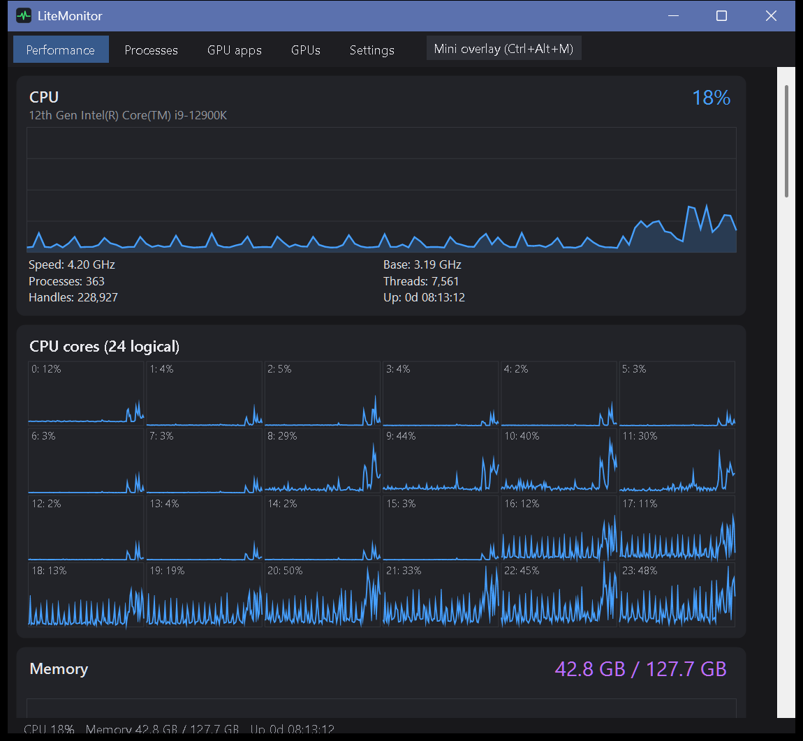
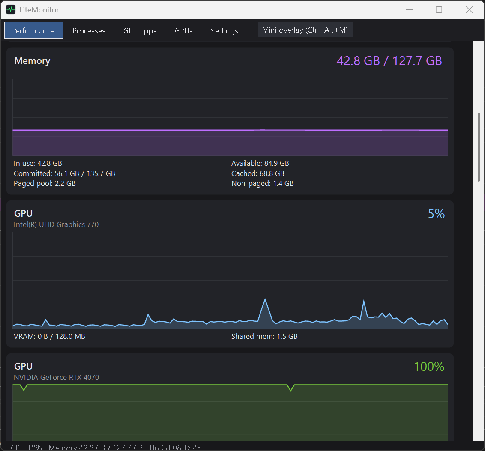
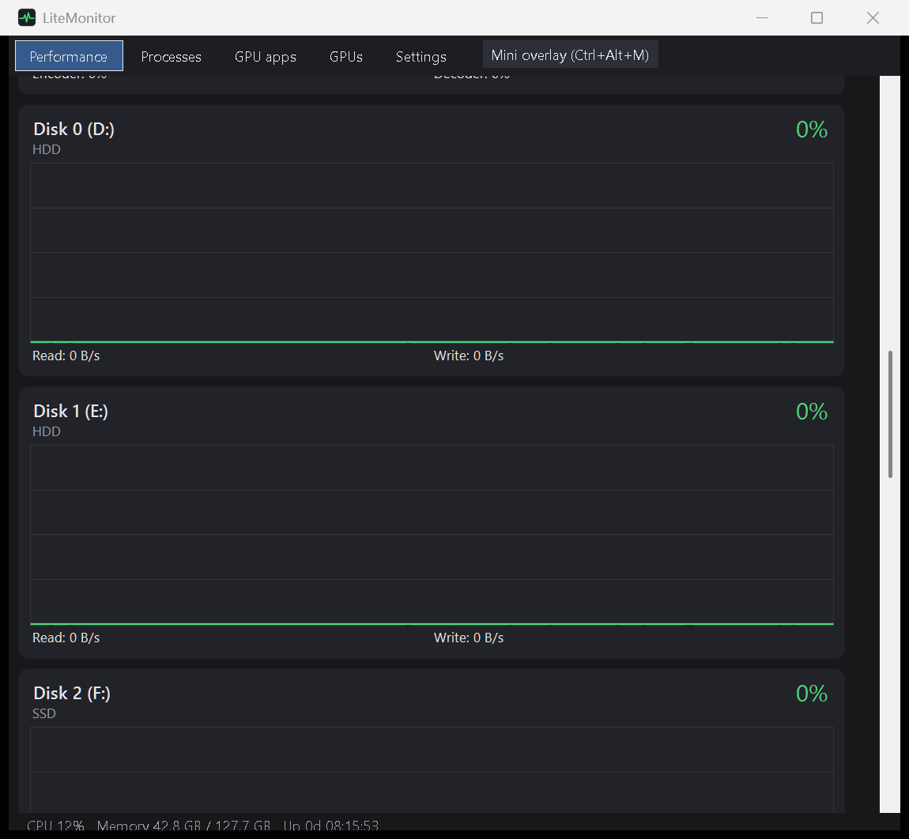
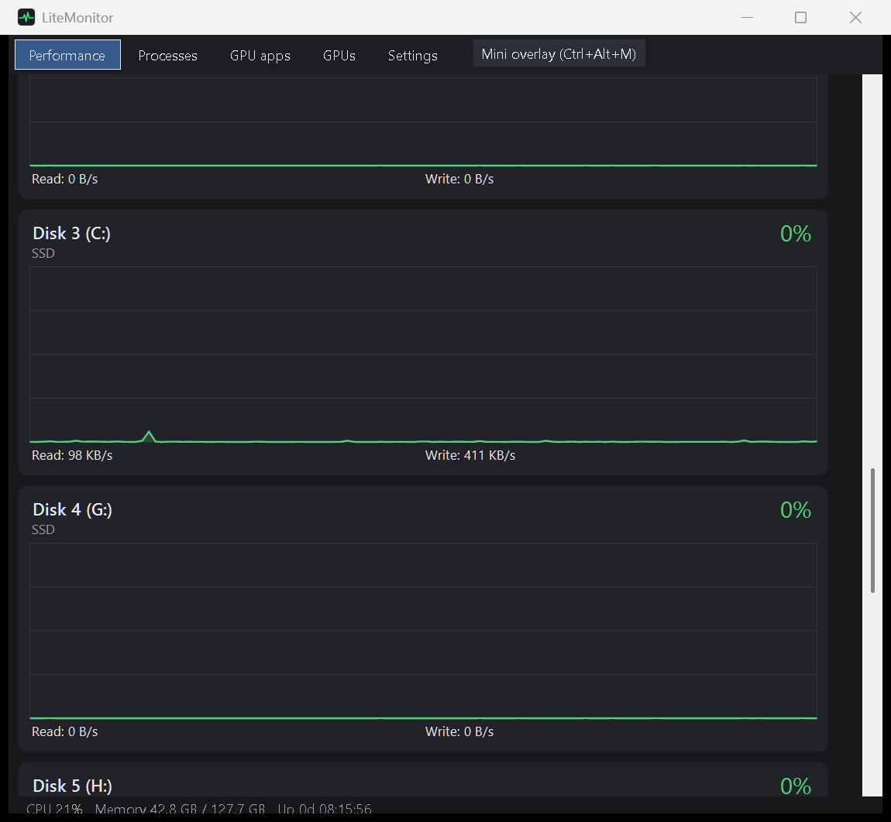
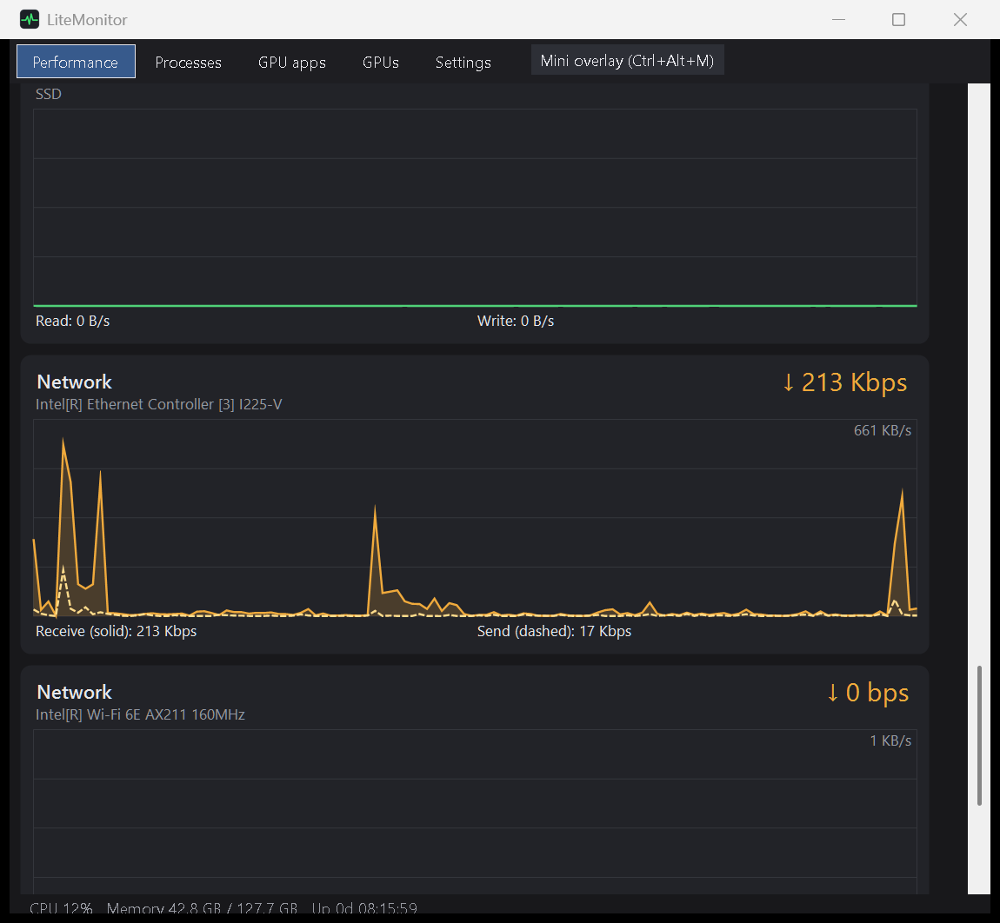
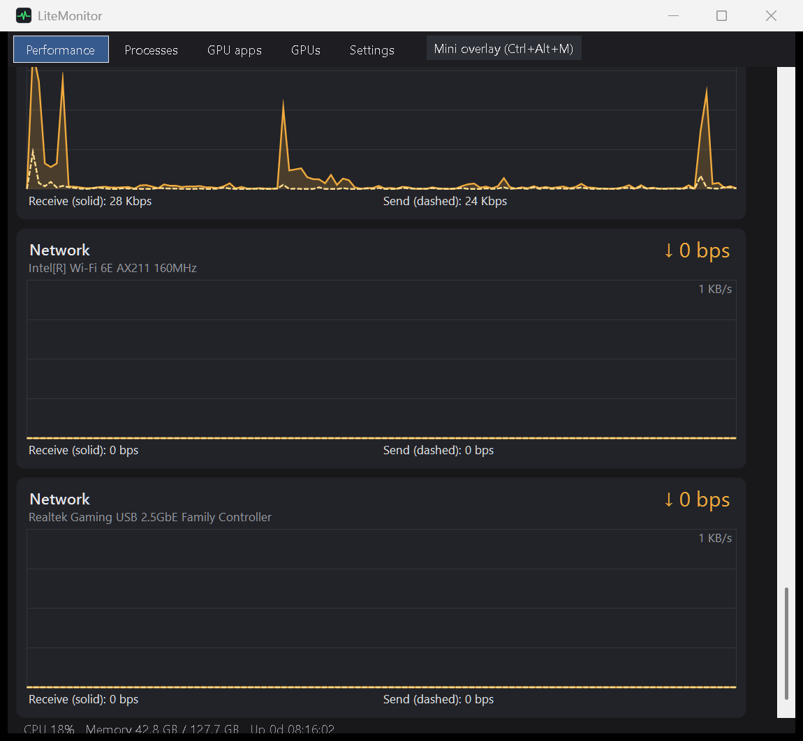
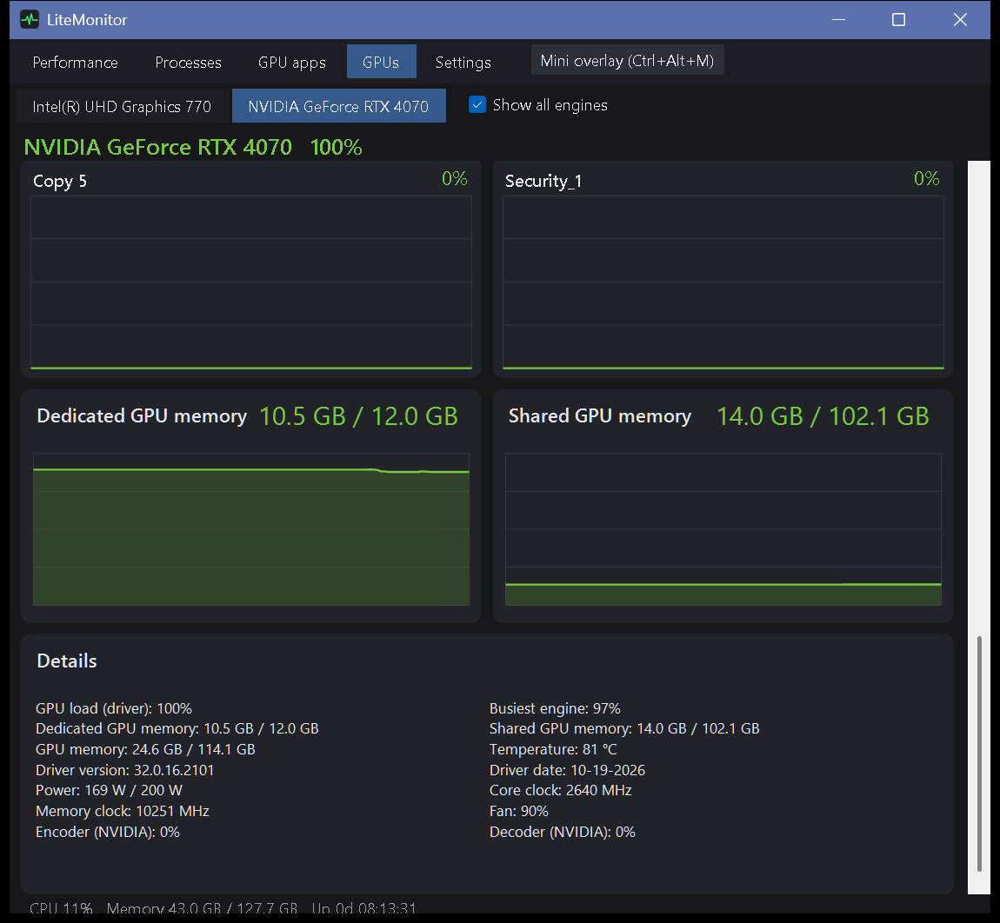
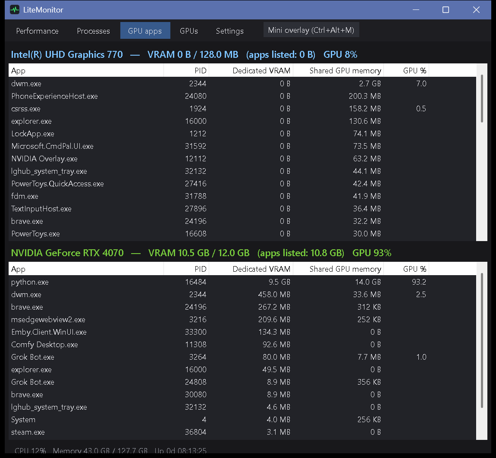
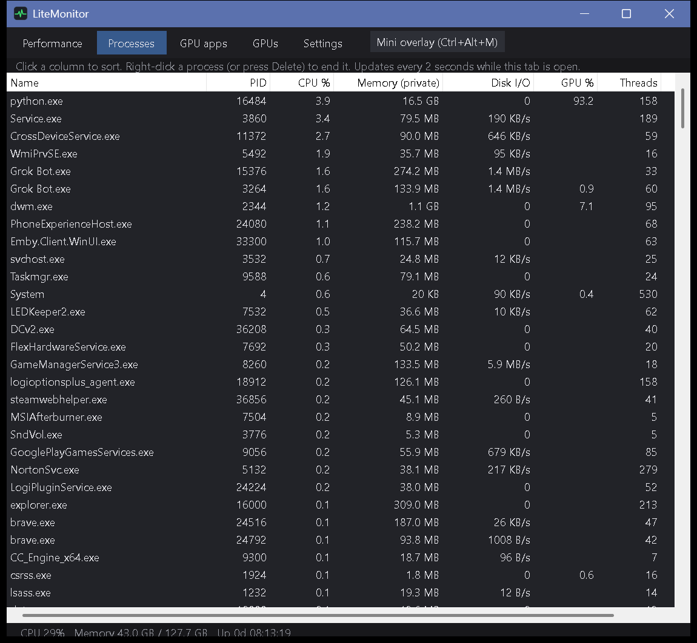

# LiteMonitor

A lightweight Windows system monitor that uses far fewer resources than Task Manager (about 0.1% CPU).

## Features
- CPU usage per core, memory, disks (with drive type and model), and network
- Detailed GPU stats (NVIDIA via NVML, plus Intel/AMD via Windows counters)
- Task Manager-style GPU page per card: engine charts (3D, Copy, Video Encode/Decode, and more) with a "Show all engines" mode, plus dedicated and shared memory charts
- Click any engine or memory chart to see which apps are using it and how much
- Per-GPU list of apps with their VRAM use and GPU load
- Top processes list
- Always-on-top mini overlay for gaming, and a tray icon
- No admin rights or drivers needed

## Screenshots

### Performance







### GPUs (per-card engine and memory charts)


### GPU apps (VRAM and GPU load per app)


### Processes


## Download
Grab `LiteMonitor.exe` from the [Releases](../../releases) page and run it. No install needed.

## Build from source
Requires the .NET 8 SDK on Windows:

```
cd src
dotnet publish -c Release -r win-x64 --self-contained -p:PublishSingleFile=true -o ../publish
```
